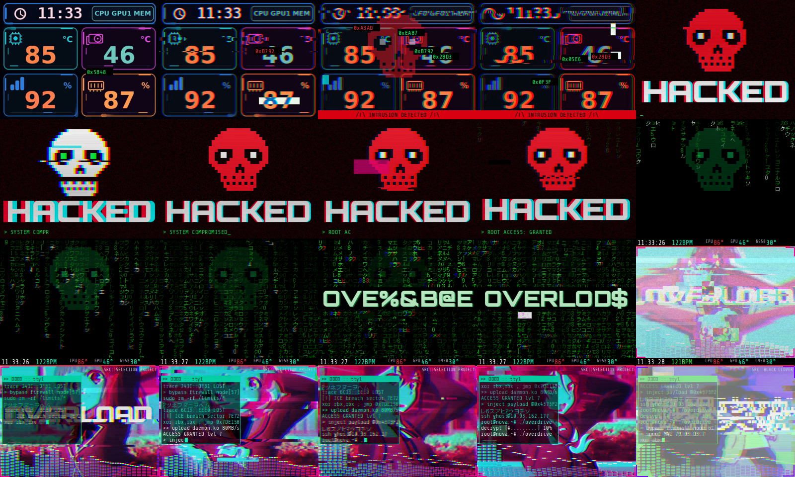
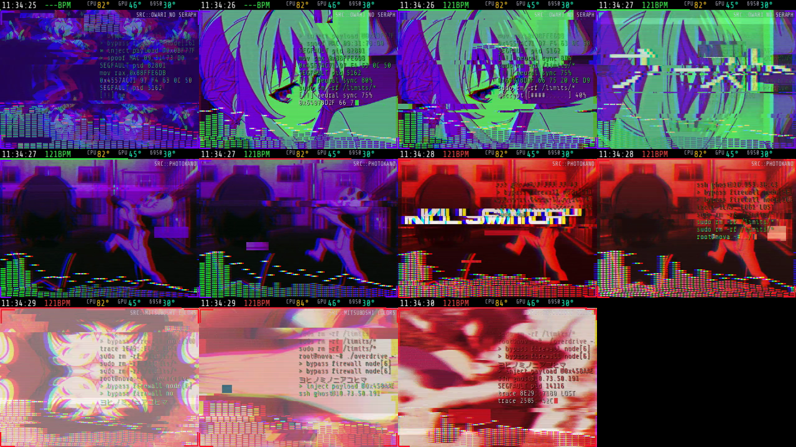
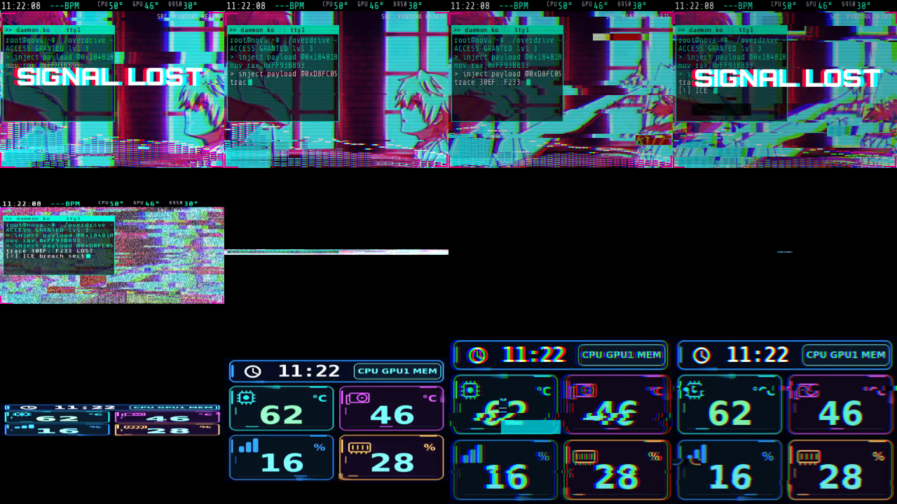

# TRCC RAVE — l'écran Thermalright qui pète les plombs sur la musique

> Audio-reactive cyberpunk visualizer for the Thermalright 320×240 cooler LCD (USB `0402:3922`)
> on Linux. It listens to your speakers, shows your system monitoring when the music is calm,
> and switches to an **OVERLOAD** mode with glitches, anime GIFs cut on the beat, hacker
> lines and matrix rain when the music hits hard.



## Deux modes
**MONITORING** : affichage calme des températures, charges, mémoire et heure. Il est actif
sans musique (6 s de silence), avec de la musique douce, ou quand la musique reste calme 8 s.

**OVERLOAD** : il se déclenche quand la « chaleur » de la musique dépasse 0.60 pendant 3 s.
- Intro de 6 s : infection glitch du monitoring, puis tête de mort pixel art **HACKED**
  dont la mâchoire claque sur les kicks, puis pluie Matrix verte, puis OVERLOAD qui se
  déchiffre, puis explosion.
- GIFs d'anime coupés tous les 4 kicks (tous les 2 en drop), lecture accélérée jusqu'à 2,2x
  et calée sur le BPM, stutter.
- Zoom punch, tremblement, strobe blanc/néon, miroir/mosaïque/kaléidoscope sur les beats.
- RGB split, slices décalées, blocs corrompus, datamosh, neige, scanlines CRT.
- Lignes de hack tapées en direct (hex, shellcode, katakana), sans fenêtre, en fondu.
- Gros mots glitchés (BREACH, OVERDRIVE, 暴走, 限界突破…) et spectre néon 32 bandes.
- Transition de sortie : « SIGNAL LOST », puis extinction de tube CRT, puis rallumage
  du monitoring.




## La « chaleur »
Le son de la sortie par défaut est capté via le moniteur PipeWire. Rien n'est enregistré.
Une FFT tourne en continu. Sur 6 s, quatre mesures sont combinées :
- la densité d'attaques ;
- la platitude spectrale (synthés saturés, charlestons) ;
- la dynamique compressée ;
- le niveau.

Le résultat ne dépend presque pas du volume. Calibration sur des morceaux de référence :

| Morceau | Chaleur | Mode |
|---|---|---|
| Piano, acoustique | 0.0 – 0.2 | monitoring |
| Lo-fi, jazz, pop joyeuse | 0.2 – 0.55 | monitoring |
| Électro / rock énervé | 0.8 – 1.0 | OVERLOAD en 8 à 16 s |

Réglages en haut de `rave.py` : `ENTER_HEAT`, `ENTER_HOLD`, `LEAVE_HEAT`, `LEAVE_HOLD`,
`SILENCE_HOLD`, ainsi que les durées de l'intro dans `Intro.LONG`.

## Prérequis
- Linux avec PipeWire (`pw-record`), `ffmpeg`, `python3-numpy`, `python3-pil`
- [thermalright-trcc-linux](https://github.com/Lexonight1/thermalright-trcc-linux) installé
  (commande `trcc`), avec son daemon lancé dans la session
- LCD Thermalright SCSI `0402:3922` (profil FBL51, 320×240), orientation 0°

## Installation
```bash
git clone https://github.com/PourrezJ/thermalright-lcd-rave.git ~/.local/share/trcc-custom/rave-v7
cd ~/.local/share/trcc-custom/rave-v7
./install.sh      # polices, 81 GIFs d'anime (nekos.best, SFW), service systemd --user
./activate.sh     # démarre maintenant et à chaque ouverture de session
```

## Commandes
- `journalctl --user -u trcc-rave -f` : logs (chaleur et composantes toutes les 30 s)
- `python3 rave.py --preview 12` : rendu de test dans `preview/` sans toucher au LCD
- `python3 rave.py --preview 10 --force in --audio-file morceau.mp3` : rejoue l'intro
- `python3 rave.py --analyze *.mp3` : chaleur hors ligne et bascules prévues
- `python3 fetch_gifs.py --per 30 dance punch` : plus de GIFs
- Tes propres GIFs ou MP4 vont dans `gifs/`. Les préfixes `punch-`, `kick-`, `shoot-`, `yeet-`
  et `run-` marquent des clips de frappe, privilégiés pendant les drops.
- `./restore-v6.sh` : revient au service Nova V6, s'il existe

## Technique
- Chaque image 320×240 est entièrement composée en Python (numpy + Pillow).
- Elle est tournée selon l'angle « fil » du profil SCSI FBL51 de TRCC, puis encodée en
  RGB565 big-endian.
- L'envoi passe par la commande publique TRCC `SendFrame`, dans un thread dédié.
- Performances : 20 FPS, environ 6 à 15 ms de rendu par image, environ 20 à 30 % d'un cœur.
- Le paquet TRCC, le firmware et les règles USB ne sont pas modifiés.
- Le mode monitoring réutilise le rendu « Nova V6 » s'il est présent
  (`../nova-fullscroll-v6/fullscroll.py`). Sinon, un tableau de bord simplifié s'affiche.
- Le HUD lit les capteurs TRCC `cpu:temp`, `gpu:primary:temp` et `gpu:amd:1:temp`.
  Adapte `Sensors.IDS` et `hud()` à ta machine.

## Crédits
- Les GIFs viennent de l'API publique [nekos.best](https://nekos.best). Ils ne sont pas inclus
  dans le dépôt : les droits restent à leurs auteurs et studios.
- Polices Google Fonts (OFL), téléchargées à l'installation : Orbitron, Share Tech Mono,
  DotGothic16.

## Licence
Code sous licence MIT (voir `LICENSE`).
